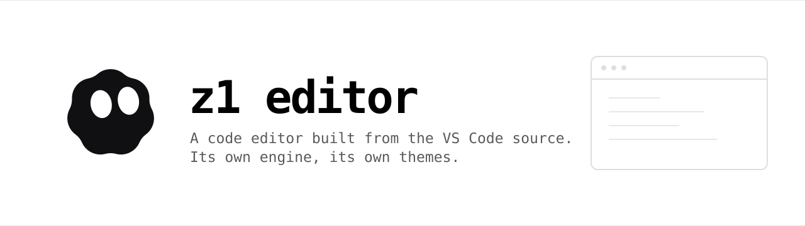

<p align="center">
  <picture>
    <source media="(prefers-color-scheme: dark)" srcset="branding/banner-dark.svg">
    
  </picture>
</p>

<p align="center">
  <a href="LICENSE.txt"></a>
  
  
</p>

**A code editor built from the VS Code source, with its own engine.**

z1 is a custom code editor built on the **Visual Studio Code** source (1.143.1)
with VSCodium's freedom-preserving patches and z1 branding.

It is not a wrapper around a prebuilt VSCode: this repository contains the
application source itself (`src/`, `extensions/`, `build/`, `resources/`) plus
the z1 brand assets and themes.

## What is different

- Telemetry is off: the telemetry level defaults to `none`, the crash reporter
  defaults to disabled, and `product.json` configures no telemetry or update
  endpoint.
- No Microsoft Marketplace: extensions come from **Open VSX**.
- z1 branding: window/app title, icon, launch command, data folder (`~/.z1`).
- Themes: **z1 Ocean** (white surfaces, black accents, default light),
  **z1 Default** (neutral dark, default dark), and **z1 Soft**.
- Cursor-style Welcome screen with `Open project`, `Clone repo`,
  `Connect via SSH`, and `About z1` cards.
- Empty-editor watermark: rotating z1 body, cursor-tracking eyes, static eyes.
- Strict 90-degree UI (all border radii are 0).
- Activity Bar is fixed to the top.

## Engine

The agent runtime is [z1-sdk](https://github.com/ayzitix/z1-sdk): a journaled
node-graph engine with modules, branch memory and a headless server. The editor
does not start it yet — integration is the next step. Today it runs from its own
CLI (`z1 run`, `z1 serve`, `z1 studio`).

## Build

Prerequisites:

- Node.js **24.18.0** (see `.nvmrc`)
- Python **3.11**
- `git`, `jq`, `gcc`, `g++`, `make`, `pkg-config`
- Linux dev headers: `libx11`, `libxkbfile`, `libsecret`, `libkrb5`
- `fakeroot` (for packaging; optional for the portable build)

```bash
npm ci
npm run gulp vscode-linux-x64-min-packing
```

The portable app is written to `VSCode-linux-x64/`. The helper script
renames it and is the recommended entry point:

```bash
./z1-build.sh
./z1-linux-x64/bin/z1
```

See [BUILD.md](BUILD.md) for details and notes.

## Development (watch)

For UI iteration, do not run the full build. In one terminal:

```bash
npm run watch
```

In another terminal, launch the dev build:

```bash
./scripts/code.sh
```

`watch` recompiles only changed sources. For a quick change to the already
packaged app, CSS can be edited in
`z1-linux-x64/resources/app/out/vs/workbench/workbench.desktop.main.css` and
the window reloaded; TypeScript changes are reflected by `watch` + the dev app.
A full `./z1-build.sh` is only needed for a new portable artifact.

## Repository layout

| path | contents |
|---|---|
| `src/vs/` | workbench, editor, platform (z1 modifications included) |
| `extensions/` | built-in extensions; `theme-defaults` contains the z1 themes |
| `build/` | build system |
| `resources/` | icons and Linux packaging resources |
| `branding/` | z1 logo, PNG/ICO sizes, watermarks, theme JSON sources |
| `product.json` | z1 product identity (name, gallery, URLs) |
| `package.json` | source package metadata |

## Documentation

Architecture, commands, decisions and gotchas live in
[z1-docs](https://github.com/ayzitix/z1-docs).

## License and attribution

z1 is distributed under the MIT license. It is based on Microsoft's Visual
Studio Code and on VSCodium's patches. See [LICENSE.txt](LICENSE.txt) and
[NOTICE.md](NOTICE.md).
